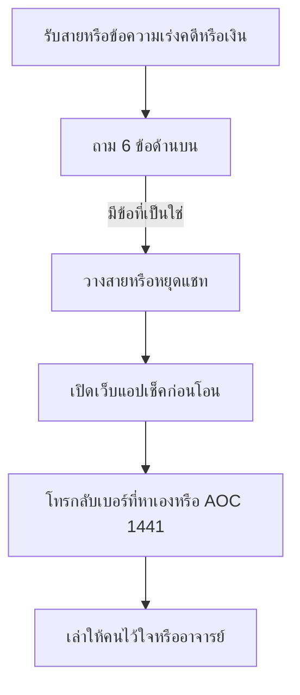
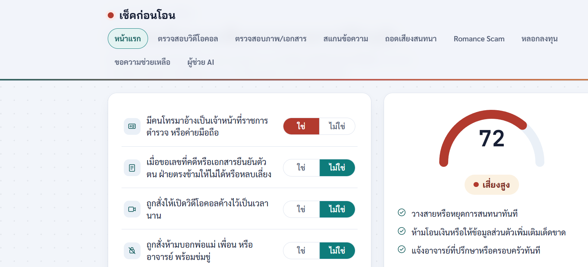
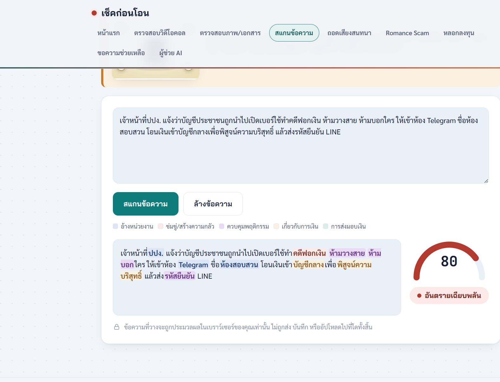
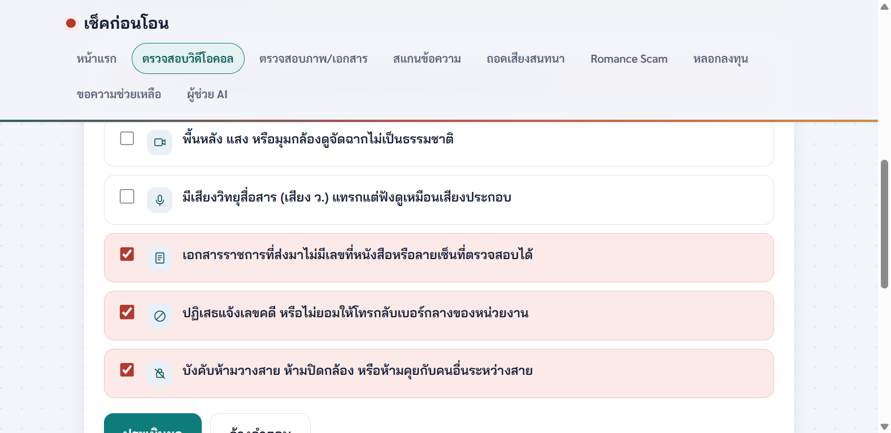
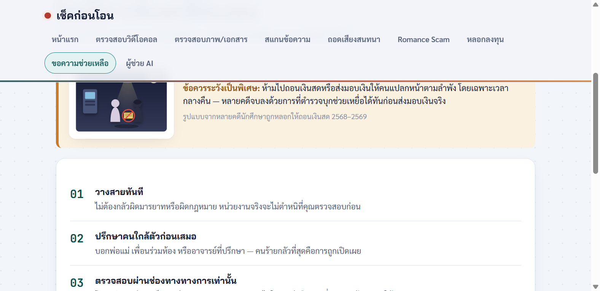

# เช็คก่อนโอน — หยุด ถาม ตรวจ ก่อนทำธุรกรรมกับคนแปลกหน้า

โปรเจกต์นี้เป็นเกราะความรู้สำหรับนักศึกษา ผู้ปกครอง และคนรอบตัว **ก่อนโอนเงิน ส่งรหัส หรือทำตามคำสั่งของคนที่อ้างตัวเป็นเจ้าหน้าที่** ไม่ว่าจะมาทางโทรศัพท์, LINE, Telegram, วิดีโอคอล หรือนัดรับเงินสด

แกนของโปรเจกต์ไม่ใช่การท่องจำมุกเก่า แต่เป็นเครื่องมือให้ **ตั้งคำถามกับตัวเองตอนกำลังตกใจ** แล้วค่อยตัดสินใจ คนฉลาดก็ยังถูกหลอกได้ เมื่อความกลัวดึงสมาธิไปที่ “คดี” จนไม่เหลือที่ว่างสำหรับเช็กข้อเท็จจริง

เว็บไซต์เผยแพร่แล้วที่: https://chiraleo2000.github.io/Cyber-Defense-Knowledge-to-Student/

เครื่องมือนี้เป็น **ตัวช่วยตัดสินใจ** ไม่ใช่คำวินิจฉัยทางกฎหมายหรือการเงิน หากกำลังถูกหลอกอยู่ ให้วางสายแล้วโทร **AOC 1441** (ตลอด 24 ชม.) หรือ **191**

---

## สถานะโปรเจกต์

| ส่วน | สถานะ | ใช้อย่างไร |
|---|---|---|
| เว็บไซต์ข้อมูล (`docs/`) | พร้อมใช้ | 12 หน้าในเมนู: คดีจริง, สคริปต์มิจฉาชีพ, หลัก 4 ไม่, คู่มือ, นโยบาย, ดาวน์โหลด PDF/โปสเตอร์ |
| เว็บแอปประเมินความเสี่ยง (`/webapp/`) | พร้อมใช้ | แบบประเมินสถานการณ์, ตรวจวิดีโอคอล, สแกนข้อความ, ตรวจภาพ, Romance/ลงทุน, ถอดเสียง, ขั้นตอนขอความช่วยเหลือ |
| ผู้ช่วย AI (Pathumma ผ่าน Cloudflare Worker) | ใช้ได้เมื่อ deploy | ถ้ายังไม่ deploy แชทจะตอบด้วยกฎคำสำคัญแบบออฟไลน์ |
| แอปเตือนสายเรียลไทม์ / LINE OA | ยังเป็นแนวคิด | ดูหน้า [แผนพัฒนาต่อ](docs/content/แผนพัฒนาต่อ.md) — อย่าเข้าใจว่ามีให้ใช้แล้ว |

รายละเอียดสิ่งที่มีจริงกับแผนอนาคตแยกไว้ที่ `docs/content/แผนพัฒนาต่อ.md` เพื่อไม่ให้ปนกัน

---

## ใครควรเปิดอะไร

- **กำลังคุยสายหรือแชทอยู่ และเริ่มไม่แน่ใจ** — วางสายหรือหยุดพิมพ์ก่อน แล้วเปิด [เว็บแอป](https://chiraleo2000.github.io/Cyber-Defense-Knowledge-to-Student/webapp/) ทำแบบประเมินหน้าแรก
- **นักศึกษา** — อ่าน [รู้ทันสคริปต์มิจฉาชีพ](docs/content/รู้ทันสคริปต์มิจฉาชีพ.md) ก่อนเกิดเหตุ และ [ถูกหลอกแล้วทำอย่างไร](docs/content/ถูกหลอกแล้วทำอย่างไร.md) ถ้าโอนไปแล้ว
- **ผู้ปกครอง** — ถ้าลูกขอเงินก้อนเรื่องทุนการศึกษา กะทันหันส่งภาพเหมือนถูกทำร้าย หรือหายจากที่พัก ให้ **โทรหานักศึกษาโดยตรงด้วยเบอร์ที่ครอบครัวมีอยู่เดิม** และเช็กกับอาจารย์ที่ปรึกษาของมหาวิทยาลัยก่อนโอน อย่าคุยต่อในห้องแชทที่อีกฝ่ายเปิดให้
- **อาจารย์ / เจ้าหน้าที่มหาวิทยาลัย** — ใช้ [คู่มือรับมือ](docs/content/คู่มือรับมือ.md) และ [ข้อเสนอแนะเชิงนโยบาย](docs/content/ข้อเสนอแนะเชิงนโยบาย.md) โปสเตอร์อยู่ที่หน้าดาวน์โหลด

---

## ใช้ยังไงเพื่อไม่ให้โดนหลอก

### กฎก่อนทำธุรกรรม ทุกช่องทาง

จำคู่กับหลัก **4 ไม่** ของหน่วยงานรัฐ (ไม่กดลิงก์ / ไม่เชื่อ / ไม่รีบ / ไม่โอน) แล้วเติมอีก 3 ข้อที่ใช้กับมุกล่าสุด:

1. **ไม่บอกรหัส** — OTP, รหัสยืนยัน LINE, รหัสธนาคาร ไม่มีหน่วยงานจริงขอทางโทรศัพท์หรือแชท
2. **ไม่ย้ายไปแอปที่เขาชี้** — ห้อง Telegram ชื่อ “ห้องสอบสวน”, LINE ส่วนตัว, วิดีโอคอลค้างไว้ ไม่ใช่ช่องสอบสวนของรัฐ
3. **ไม่ย้ายที่พักหรือเปลี่ยนเบอร์ตามคำสั่งคนแปลกหน้า** — การถูกตัดขาดจากครอบครัวคือเป้าหมายของขบวนการ ไม่ใช่ขั้นตอนคดี

ไม่มีหน่วยงานใดให้โอนเงินเพื่อ “พิสูจน์ความบริสุทธิ์” หรือโอนเข้า “บัญชีตรวจสอบ” แล้วจะคืนให้

### คำถามบังคับ 6 ข้อ (ใช้ตอนตกใจ)

ถามตัวเอง หรือส่งให้เพื่อน/รูมเมทถามให้ ก่อนโอน ส่งรหัส ย้ายห้อง หรือเปลี่ยนซิม **ถ้าข้อใดข้อหนึ่งเป็น “ใช่” ให้หยุด**

1. มีคนเร่งเรื่องคดี เงิน หรือความลับ ทั้งที่คุณไม่ได้เป็นฝ่ายเริ่มติดต่อหรือไม่
2. ถูกสั่งห้ามบอกพ่อแม่ เพื่อน อาจารย์ หรือห้ามวางสายหรือไม่
3. ให้คุยต่อทาง LINE, Telegram หรือวิดีโอส่วนตัว แทนหนังสือ/เบอร์กลางของหน่วยงานหรือไม่
4. มีคำว่าพิสูจน์ความบริสุทธิ์, บัญชีตรวจสอบ, ทุนการศึกษา, ค่าไถ่ หรือขอรหัสยืนยันหรือไม่
5. ถูกสั่งให้ย้ายที่พัก เปลี่ยนเบอร์ หรือทำให้ครอบครัวเห็นว่าคุณกำลังถูกทำร้ายหรือไม่
6. ตอนนี้กลัว นอนน้อย หรืออยู่คนเดียวหรือไม่ — ถ้างั้นยังไม่ตัดสินใจเรื่องเงิน

ตอบ “ใช่” แล้วทำตามลำดับนี้เท่านั้น:



อย่าโทรกลับเบอร์ที่ปลายสายบอก และอย่าค้นหาชื่อหน่วยงานแล้วกดเบอร์แรกจากโฆษณา ให้เปิดเว็บทางการของหน่วยงานนั้นเอง หรือโทร 1441

### คำถามข้อไหน ไปเครื่องมือไหน

| ถ้าสงสัยเรื่องนี้ | เปิดในเว็บแอป |
|---|---|
| ยังประกอบภาพรวมไม่ออก | แบบประเมินหน้าแรก — ตอบตามสิ่งที่เกิดจริง ระบบชี้เครื่องมือต่อให้ |
| บทแชทมีคำว่าห้องสอบสวน, บัญชีตรวจสอบ, ทุน, ค่าไถ่, รหัส LINE | สแกนข้อความ (วางบทสนทนา ระบบไฮไลต์คำเสี่ยง) |
| วิดีโอคอลอ้างตัวเป็นตำรวจ / เครื่องแบบ / ห้ามปิดกล้อง | ตรวจสอบวิดีโอคอล |
| ได้ไฟล์ภาพเอกสารราชการหรือภาพขู่ | ตรวจสอบภาพ/เอกสาร |
| มีไฟล์เสียงสายสนทนา | ถอดเสียง แล้วสแกนข้อความต่อ |
| คนออนไลน์ที่ไม่เคยเจอตัวขอเงิน หรือชวนลงทุนผลตอบแทนสูง | Romance Scam / หลอกลงทุน |
| รู้แล้วว่าต้องวางสาย แต่ไม่รู้จะทำอะไรต่อ | ขอความช่วยเหลือ |
| อยากเล่าสถานการณ์เป็นประโยค | ผู้ช่วย AI (ถ้ายังไม่ต่อ Worker จะตอบจากกฎคำสำคัญ) |

### หน้าตาในเว็บแอป

เปิด [เว็บแอปเช็คก่อนโอน](https://chiraleo2000.github.io/Cyber-Defense-Knowledge-to-Student/webapp/) แล้วเลือกแท็บตามสิ่งที่กำลังเจอ ภาพด้านล่างเป็นหน้าจอจริงของเครื่องมือ คะแนนเป็นสัญญาณเตือนให้หยุด ไม่ใช่คำตัดสินว่าอีกฝ่ายผิด

**แบบประเมินหน้าแรก** ตอบ “ใช่” เฉพาะข้อที่กำลังเกิดจริง เกจทางขวาบอกระดับความเสี่ยงและขั้นถัดไป เช่น วางสาย ห้ามโอน และบอกคนใกล้ตัว



**สแกนข้อความ** วางบทแชทที่ได้มา ระบบไฮไลต์คำที่พบบ่อยในคดี เช่น ห้องสอบสวน, บัญชีกลาง, พิสูจน์ความบริสุทธิ์, รหัสยืนยัน แล้วสรุปเป็นคะแนน



**ตรวจสอบวิดีโอคอล** ติ๊กสิ่งที่เห็นในสาย รายการที่เข้าข่ายจะขึ้นสีแดง เช่น ไม่มีเลขคดีให้โทรกลับ หรือถูกห้ามวางสาย



**ขอความช่วยเหลือ** เมื่อรู้แล้วว่าต้องหยุด หน้านี้เรียงสิ่งที่ทำได้ทันที เริ่มจากวางสาย ปรึกษาคนใกล้ตัว และโทรกลับช่องทางที่หาเอง



หน้ารายละเอียดบนเว็บที่ควรอ่านคู่กัน: [รู้ทันสคริปต์มิจฉาชีพ + ดึงสติก่อนโอน](docs/content/รู้ทันสคริปต์มิจฉาชีพ.md) (จำสั้น ๆ ว่า **หยุด–หายใจ–ตรวจ–เล่า**) และ [สถิติและคดีจริงในไทย](docs/content/คดีจริงในไทย.md)

### มุกที่ต้องรู้จากข่าว ต.ค. 2569

สรุปจากข่าว ไม่ใช่คำแนะนำให้ทำตาม สืบนครบาลช่วยนักศึกษาชายย่านปทุมวันเมื่อ 17 ต.ค. 2569 หลังถูกแก๊งคอลเซ็นเตอร์หลอก แหล่งข่าว: [Thai PBS](https://www.thaipbs.or.th/news/content/571218), [คลิปข่าว](https://www.youtube.com/watch?v=m4hGue0EZdM)

ลำดับที่ครอบครัวและนักศึกษาน่าจะเจอ:

1. โทรอ้างค่ายมือถือ ว่ามีคนนำเลขบัตรประชาชนไปเปิดเบอร์แล้วใช้หลอกลวง/ฟอกเงิน — **การทราบเลข 13 หลักไม่ทำให้สายนั้นเป็นของจริง**
2. โอนสายให้คนที่อ้างว่าเป็นตำรวจต่างจังหวัด แล้วสั่งให้เข้า Telegram ในห้องชื่อ “ห้องสอบสวน”
3. ข่มขู่ให้โอนเงินเพื่อตรวจเส้นทางเงิน (คดีนี้ผู้เสียหายโอนไปแล้ว 36,000 บาท)
4. สั่งย้ายออกจากที่พักไปห้องรายวัน ปิดเบอร์เดิม เปิดเบอร์ใหม่ เพื่อไม่ให้ครอบครัวติดต่อได้
5. หลอกเอา **รหัสยืนยัน LINE** แล้วใช้บัญชีนั้นติดต่อคนในครอบครัว
6. เมื่อเหยื่อไม่มีเงินเหลือ จึงสั่งให้บอกที่บ้านว่าได้ทุนเรียนต่อ ต้องใช้เงินประมาณ 200,000–300,000 บาท และให้สร้างภาพเหมือนถูกทำร้ายหรือถูกกักขังเพื่อกดดันผู้ปกครอง

สิ่งที่ทำให้เคสนี้จบก่อนความเสียหายบานคือผู้ปกครอง **ไม่เชื่อเรื่องทุน** แล้วเช็กกับอาจารย์ของมหาวิทยาลัย จึงรู้ว่าไม่มีทุนดังกล่าว และแจ้งตำรวจ ขณะเข้าช่วย นักศึกษายังคุยสายกับขบวนการอยู่ — พอมีตำรวจถึงตัว ปลายสายตัดสายทันที

ผู้ปกครอง: ภาพเลือด ภาพมัดตัว หรือข้อความขอเงินก้อนจากบัญชีของลูก **อาจเป็นบัญชีที่ถูกยึดแล้ว** ให้ติดต่อลูกด้วยช่องทางเดิม และแจ้งตำรวจในพื้นที่ อย่าโอนตามจำนวนที่ห้องแชทเร่ง

### ทำไมคนเก่งก็ยังโดน — แล้วจะกันยังไง

มิจฉาชีพไม่ได้ชนะที่ “เหยื่อโง่” แต่ทำให้ใช้เหตุผลที่ตัวเองมีไม่ได้ คลิปวิเคราะห์คดีนักศึกษาแพทย์ที่สูญเกือบ 11 ล้านบาทโดย ดร.ธนีวัลย์ อธิบายกลไกนี้ไว้ตรง ๆ: [YouTube](https://www.youtube.com/watch?v=5M53qqfhk-o) หน้าเว็บของโปรเจกต์เรียกภาวะกลัวจัดว่า Amygdala Hijack — สมองส่วนอารมณ์กลบส่วนคิด

กรอบที่ใช้ตั้งคำถาม 6 ข้อด้านบน:

| กลไก | สิ่งที่ขบวนการทำ | คำถามที่ตัดทางนี้ |
|---|---|---|
| อุโมงค์ความคิด (cognitive tunnel) | โยนภัยใหญ่เรื่องคดี/อนาคต/พ่อแม่ จนมองไม่เห็นอย่างอื่น | ข้อ 1 — เรื่องนี้ถูกเร่งให้ใหญ่เกินกว่าจะตรวจหรือไม่ |
| อำนาจ (authority) | เครื่องแบบ ศัพท์กฎหมาย ต่อสาย “ตำรวจ” | ข้อ 3 — ยอมให้โทรกลับเบอร์ที่คุณหาเองหรือไม่ |
| ความสอดคล้อง (consistency) | ขอเงินก้อนเล็กก่อน แล้วก้อนต่อไปจะง่าย เพราะสมองไม่อยากยอมรับว่าก้อนแรกพลาด | ข้อ 4 — เคยโอนไปแล้วหรือยัง ถ้างั้นหยุดก้อนถัดไป |
| ตัดขาด (isolation) | ห้ามบอกใคร ย้ายห้อง เปลี่ยนเบอร์ ยึด LINE ให้ครอบครัวได้ยินเรื่องปลอม | ข้อ 2 และ 5 — ถ้าเขาห้ามให้คุณมีคนที่สอง นั่นคือสัญญาณ |
| ภาระทางความคิด (cognitive load) | กดดันให้ตัดสินตอนกลัว ง่วง ไม่ได้พัก | ข้อ 6 — ยังไม่โอนจนกว่าจะออกจากภาวะนั้น |
| รู้ตอนสงบ แต่ลืมตอนร้อน (cold vs hot) | คำเตือนที่เคยอ่านหายไปทันทีที่อยู่ในสาย | เลยต้องมีรายการคำถามสั้น ๆ และเครื่องมือกดได้ ไม่ใช่บทความยาวตอนกำลังคุย |

จุดที่ขบวนการกลัวไม่ใช่สติปัญญาของเหยื่อ แต่คือ **คนที่สอง** ที่ได้ยินเรื่องแล้วไปเช็ก เป้าหมายของเครื่องมือนี้คือให้คุณหลุดจากสาย แล้วหาความเห็นที่สองก่อนมีธุรกรรมใด ๆ

ตั้งวงเงินโอนต่อวันกับธนาคารไว้ล่วงหน้าตอนที่ยังสงบ จะกันยอดเสียหายได้แม้ตัดสินใจพลาดในวันนั้น

---

## โครงสร้างโปรเจกต์

```
.
├── .github/workflows/
│   ├── deploy-pages.yml       ← publish docs/ ไปสาขา gh-pages เมื่อ push เข้า main
│   └── deploy-worker.yml      ← deploy Cloudflare Worker (กด Run เอง)
├── docs/                      ← เว็บที่ GitHub Pages เสิร์ฟ
│   ├── index.html             ← SPA อ่าน Markdown
│   ├── content/*.md           ← เนื้อหา (แก้ที่นี่)
│   ├── assets/                ← CSS, JS, ฟอนต์ Sarabun (self-host)
│   ├── downloads/             ← PDF + โปสเตอร์
│   └── webapp/index.html      ← เว็บแอปที่เผยแพร่จริง
├── webapp-source/
│   └── check-kon-oon.html     ← ต้นฉบับเว็บแอป (แก้ที่นี่ แล้วคัดลอกทับ docs/webapp/)
├── worker/                    ← ตัวกลางซ่อน API key ของผู้ช่วย AI
├── tools/                     ← build PDF และทดสอบเว็บ
├── AGENT-SETUP.md             ← เปิดผู้ช่วย Pathumma ทีละขั้น
├── USER-MANUAL.md             ← วิธีใช้เว็บ + บันทึกผลทดสอบ
└── README.md
```

ทุกหน้ามีทั้ง `docs/content/<ชื่อไทย>.md` และ `docs/downloads/<ชื่อไทย>.pdf` รายการหน้าอยู่ใน `PAGES` ของ `docs/assets/js/app.js`

เมื่อแก้หรือเพิ่มหน้า:

1. แก้ไฟล์ `.md` ใน `docs/content/`
2. ถ้าเป็นหน้าใหม่ ให้เพิ่มใน `PAGES` ของ `app.js` และลิงก์ใน `docs/content/ดาวน์โหลด.md`
3. สร้าง PDF: `python tools/build_pdfs.py` (ต้องมี Python package `markdown` และ Chrome หรือ Edge)
4. ถ้าแก้เว็บแอป ให้แก้ `webapp-source/check-kon-oon.html` แล้วคัดลอกทับของที่เผยแพร่:

```powershell
Copy-Item webapp-source\check-kon-oon.html docs\webapp\index.html
```

---

## รันในเครื่อง

จากโฟลเดอร์ `docs/`:

```powershell
python -m http.server 8910
```

เปิด http://localhost:8910/ และ http://localhost:8910/webapp/

อีกเทอร์มินัลหนึ่ง ที่รากโปรเจกต์:

```powershell
python tools/test_site.py 8910
```

สคริปต์ตรวจว่าหน้า Markdown, PDF และโปสเตอร์ตอบ HTTP 200 และลิงก์ภายในไม่เสีย ผ่านเมื่อ exit code เป็น 0

---

## เผยแพร่เว็บและผู้ช่วย AI

Workflow `.github/workflows/deploy-pages.yml` คัดลอก `docs/` ไปสาขา `gh-pages` ทุกครั้งที่ push เข้า `main`

ตั้งค่าครั้งเดียวหลังมีสาขา `gh-pages` แล้ว: repo → **Settings → Pages** → Source = **Deploy from a branch** → Branch `gh-pages` โฟลเดอร์ `/ (root)`

ผู้ช่วย AI ฝังคีย์ในหน้าเว็บไม่ได้ เพราะ Pages เป็นไฟล์นิ่ง ต้องมี Cloudflare Worker เก็บคีย์ไว้ฝั่งเซิร์ฟเวอร์ ขั้นตอนละเอียดอยู่ใน [`AGENT-SETUP.md`](AGENT-SETUP.md) สั้น ๆ:

1. ใส่ GitHub Secrets: `CLOUDFLARE_API_TOKEN`, `CLOUDFLARE_ACCOUNT_ID`, `UPSTREAM_API_KEY`, `UPSTREAM_BASE_URL`
2. Actions → **Deploy Cloudflare Worker** → Run workflow
3. เปิดเว็บแอปครั้งเดียวด้วย `?agent=https://<worker>.workers.dev/chat` เบราว์เซอร์จะจำ URL ไว้

ค่า upstream ที่โปรเจกต์ใช้อยู่คือ ThaiLLM Playground (`http://thaillm.or.th/api/v1`, โมเดล `pathumma-thaillm-qwen3-8b-think-3.0.0`) ดู `worker/README.md` ถ้ายังไม่ deploy เว็บแอปส่วนอื่นใช้ได้ตามปกติ

---

## ความโปร่งใสของเนื้อหา

- ตัวเลขและคดีใน [คดีจริงในไทย](docs/content/คดีจริงในไทย.md) และคู่มือเร่งด่วนอ้างข่าวหรือหน่วยงานที่ตรวจได้ มีลิงก์กำกับ
- [มุมมองระดับโลก](docs/content/มุมมองระดับโลก.md) ใส่เฉพาะสถิติที่ยืนยันได้ (FBI IC3 2024) ไม่ใส่เคสต่างประเทศที่ยังตรวจแหล่งไม่ครบ
- [แบบสำรวจความตระหนักรู้](docs/content/แบบสำรวจความตระหนักรู้.md) เป็นแบบพร้อมใช้ **ยังไม่มีการเก็บข้อมูลจริง**
- คดี 16–17 ต.ค. 2569 สรุปตามข่าว Thai PBS และคลิปรายงาน ไม่ได้ยืนยันข้อเท็จจริงเกินกว่าที่แหล่งข่าวนั้นระบุ (ข่าวไม่เปิดชื่อมหาวิทยาลัย)

---

## ข้อจำกัด

- **Whisper ในเบราว์เซอร์** (`Xenova/whisper-tiny`) ถอดภาษาไทยได้จำกัดกว่าโมเดลที่ฝึกเฉพาะภาษาไทย มีข้อความเตือนในหน้าเว็บแอป
- **การค้นหาในเมนูเว็บ** กรองจากชื่อหัวข้อและคำสำคัญใน `app.js` ยังไม่ค้นเต็มหน้า
- **คะแนนในเว็บแอป** เป็นสัญญาณเตือนจากรายการที่ผู้ใช้ติ๊กเอง ไม่ได้พิสูจน์ว่าอีกฝ่ายเป็นมิจฉาชีพหรือไม่
- แนวคิดแอปฟังสายสดยังไม่ถูกสร้าง และต้องออกแบบให้ประมวลผลในเครื่อง เปิดปิดเองได้ เพื่อไม่ให้กลายเป็นเครื่องมือดักฟัง

---

## มีส่วนร่วม

พบมุกใหม่หรือลิงก์ข่าวเสีย เปิด Issue หรือ Pull Request ได้ อย่า commit คีย์ API, ไฟล์ `.env` หรือข้อมูลส่วนบุคคลของผู้เสียหาย

ไฟล์เนื้อหา โปสเตอร์ และโค้ดเปิดให้ใช้ ปรับ และแชร์ต่อได้เพื่อความปลอดภัยสาธารณะ ก่อนยกสถิติไปอ้างต่อ ให้เปิดแหล่งในหน้านั้นอีกครั้งเพราะตัวเลขเปลี่ยนตามรอบรายงานของหน่วยงาน

คู่มือใช้เว็บและบันทึกการทดสอบ: [`USER-MANUAL.md`](USER-MANUAL.md)
